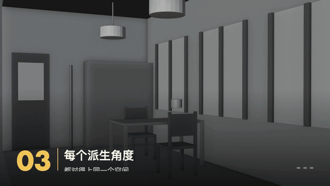
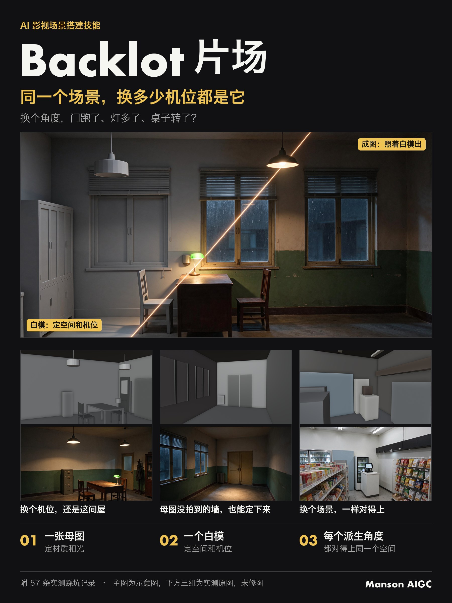
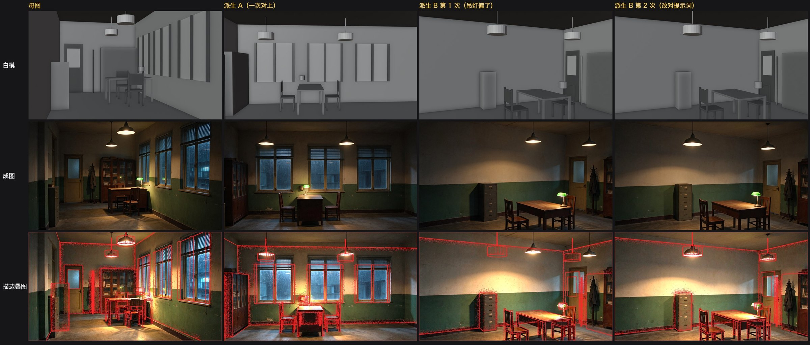
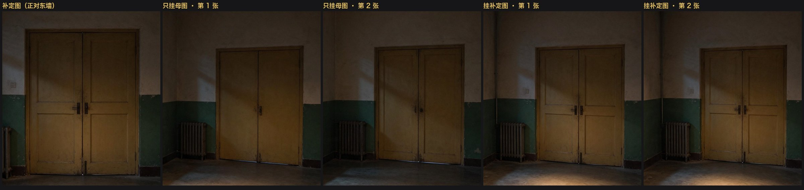
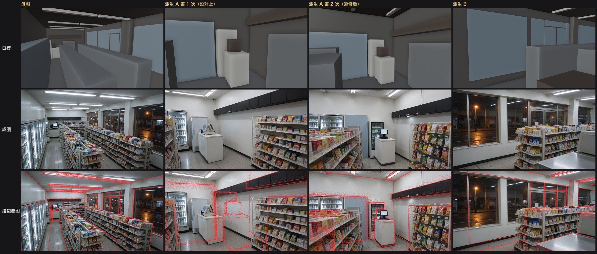

# Backlot 片场

**同一个场景，换多少机位都是它。**

一套给 AI 智能体用的影视场景搭建技能：一张母图定材质和光，一个 Blender 白模定空间和机位，再派生出同一个场景的多个角度。正打、反打、俯视都对得上同一个空间，不会出现门换了位置、灯多了几盏、桌子转了方向这些问题。

[](https://cdn.jsdelivr.net/gh/manson341349-beep/backlot@main/assets/backlot-promo.mp4)

上面是视频里的一段。完整视频 39 秒，带音乐：[在线播放](https://cdn.jsdelivr.net/gh/manson341349-beep/backlot@main/assets/backlot-promo.mp4) ｜ [下载高清版（1080P 60 帧）](https://github.com/manson341349-beep/backlot/releases/latest/download/backlot-promo-1080p60.mp4)



## 下载

**[下载技能包 backlot.zip](https://github.com/manson341349-beep/backlot/releases/latest/download/backlot.zip)**

解压后得到一个 `backlot` 文件夹，里面就是完整的技能包。当前版本 v1.4.1。

也可以直接克隆这个仓库，技能包在 `backlot/` 目录里。

## 最近更新

**v1.4.1 · 2026-11-20**

- 出图前的报价从必须改成提醒：提交前说一声用哪个模型、出几张、这一步会花钱；价格问了再报。
- 提示词卡上的「报价」一栏改成「价格（可不填）」。
- 流程和脚本的做法没有变。

完整的更新记录见 [backlot/CHANGELOG.md](backlot/CHANGELOG.md)。

## 怎么装

- **Claude Code**：把 `backlot` 文件夹放进 `~/.claude/skills/`（所有项目都能用），或项目里的 `.claude/skills/`。重开会话后生效。
- **Codex**：把文件夹放进 Codex 的技能目录，常见位置是 `~/.codex/skills/`。
- **Claude 网页版 / 桌面版**：把下载的 zip 直接传到设置里的技能页面。
- **豆包、扣子、ChatGPT、Kimi 等**：用文件夹里的 `Backlot片场_v1.4.1_单文件版.md`，对话开头贴进去或作为文件上传。

装好后直接对智能体说：

> 用 Backlot 片场帮我搭这个场景：（贴剧本片段或分镜）

完整的安装和使用说明见 [backlot/README.md](backlot/README.md)。

## 它是怎么做的

```
拿到剧本 → 拆分镜 → 【搭场景：Backlot 片场】 → 出镜头（视频 / 图片）
```

只靠提示词出同一个场景的不同角度，每张都会"像但不是同一个地方"。原因是提示词控制不了空间布局，参考图又只会把它自己的构图带过来。所以把两件事拆开管：

| 管什么 | 靠什么 |
|---|---|
| 材质、做工、色调、光的质感 | 母图（一张定好的场景图） |
| 空间布局、机位、构图、物件位置和数量 | Blender 白模的机位渲染图 |

每张派生图同时挂这两张参考图，生成出来的角度才对得上同一个空间。

## 实测

下面都是实际出图的结果，没有修图。每一列是一个机位：上面是白模，中间是成图，下面是把白模的轮廓线压在成图上。

**老办公室**：一张母图，两个派生角度。



**母图没拍到的那面墙**：先单独出一张把它定下来，再换角度拍它，门的样子保持一致。只挂母图的两张，门每次都是另一个样子。



**便利店**：换一个场景，从头走一遍。第 2 列是第一次没对上的，第 3 列是返修后的。



## 包里有什么

- `SKILL.md`：技能主文件，七步流程。
- `references/`：设定卡模板、母图写法、白模三档做法、派生提示词、自检返修、换道具、各模型注意事项，以及 57 条实测踩过的坑。
- `scripts/`：白模模板脚本（带按机位检查、未定墙面检查、露底检查）、反推母图机位、叠图、像素对比、裁块贴回。
- `examples/`：三个完整示例（老办公室、雨夜老街、两层仓库）。
- 单文件版：给不能装技能文件夹的平台用。

## 需要准备什么

- 一个能同时挂 2 张参考图的生图模型。
- Blender（推荐，免费软件，blender.org 下载）。没有也能用，走草图兜底，控制力弱一些。
- Python + Pillow（可选），跑叠图和像素对比脚本用。

实测主要在 Seedream 上完成，其他模型没有逐一测过。

## 反馈

用的过程中遇到问题，或者有新的坑，欢迎在 [Issues](https://github.com/manson341349-beep/backlot/issues) 里提。

## 许可

[CC BY 4.0](https://creativecommons.org/licenses/by/4.0/deed.zh-hans)。可以转发、修改，请保留署名：

> Backlot 片场 · Manson AIGC
